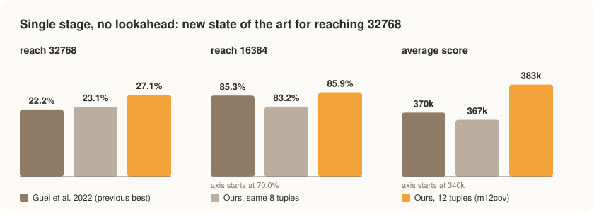
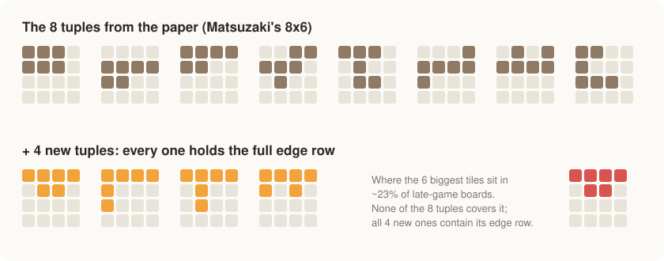

# 2048 n-tuple AI: 12 tuples, zero lookahead

> **New state of the art for single-stage, no-lookahead 2048.** Our 12-tuple network reaches the
> 32768 tile in **27.1%** of games with pure greedy play (no search) and a single set of weights.
> The best published single-stage, no-search result we know of is **22.2%** (Guei et al., 2022).

A 2048 agent that plays **without any search**. It looks at the four possible moves, asks a learned
value function which resulting board is best, and plays it. With four extra tuples that the standard
network can't express, it beats the best single-stage network in
[Guei et al., *Optimistic Temporal Difference Learning for 2048*](https://arxiv.org/abs/2111.11090)
(IEEE Transactions on Games, 2022), the paper that set the current state of the art for n-tuple
networks, on every measure the paper reports:

<p align="center"></p>

### Single stage, no lookahead (1-ply)

| network | weight sets | avg score | 8192 | 16384 | **32768** |
|---|---|---|---|---|---|
| Guei et al. 2022: 4×6-tuple, OTC (Table VII) | 1 | 280,123 | 93.00% | 67.79% | 5.32% |
| Guei et al. 2022: 8×6-tuple, OTD+TC (Table VII), **previous best** | 1 | 370,194 ± 4,366 | 97.23% | 85.30% | 22.18% ± 0.92 |
| Ours: the same 8 tuples, OTD (reproduction) | 1 | 366,817 | 96.03% | 83.22% | 23.08% ± 0.34 |
| **Ours: 12 tuples (m12cov), OTD** | **1** | **383,482** | **97.48%** | **85.93%** | **27.07% ± 0.62** |

For scale, the multi-stage networks (separate weights for different phases of the game) with no
search, from the same paper's comparison (Table X) and Table VIII:

| network | weight sets | 32768 |
|---|---|---|
| Jaśkowski 2018, 5×6-tuple MS-TC (previous overall state of the art) | 16 | 19% |
| **Ours: 12 tuples, single stage** | **1** | **27.07%** |
| Guei et al. 2022, 8×6-tuple, 2-stage | 2 | 30.17% |
| Ours: 12 tuples, 3-stage | 3 | 31.8% |
| Guei et al. 2022, 8×6-tuple, 3-stage | 3 | 33.55% |

With one set of weights, the 12-tuple network beats Jaśkowski's 16-stage network, the state of the
art before Guei et al. `±` is a 95% confidence interval; our rows come from the frozen evaluations
in [`results/`](results) (20,000 to 60,000 games each).

## The idea: more patterns, in the right place

An n-tuple network values a board by looking at it through small windows ("tuples") of 6 cells.
Every window has a lookup table with an entry for each possible arrangement of tiles in its cells
(16^6 ≈ 16.8M entries). The board's value is the sum of the table entries, with every window applied
in all 8 rotations and reflections of the board.

The paper uses Matsuzaki's 8 six-cell tuples. We looked at 9.4 million late-game boards from that
network and found that in **~23% of them, the six biggest tiles form a full edge row plus the two
middle cells below it** (`####/.##.`). None of the 8 tuples can see that shape at once, so the
network's most important tiles were split across windows that never see each other. We added four
tuples that each contain the whole edge row:

<p align="center"></p>

Cells are numbered row by row from the top-left (0 1 2 3 / 4 5 6 7 / ...):

```
paper (m8x6):  {0,1,2,4,5,6} {4,5,6,7,8,9} {0,1,2,3,4,5} {2,3,4,5,6,9}
               {0,1,2,5,9,10} {3,4,5,6,7,8} {1,3,4,5,6,7} {0,1,4,8,9,10}
new:           {0,1,2,3,5,6} {0,1,2,3,4,8} {0,1,2,3,5,9} {0,1,2,3,4,6}
```

**Is it the coverage, or just having more tuples?** We trained four variants on the same short
50-minute schedule (one stage, frozen greedy evaluation over 60,000 games):

| tuple set | 16384 | 32768 | avg score |
|---|---|---|---|
| 8 paper tuples | 79.8% | 0.02% | 301k |
| + 1 edge-row tuple | 79.6% | 0.01% | 299k |
| + 4 tuples in the middle of the board (control) | 74.5% | 0.04% | 292k |
| **+ 4 edge-row tuples (m12cov)** | **81.5%** | **15.3%** | **333k** |

Four extra tuples in the wrong place made the network *worse*. Four that cover the edge row broke
the 32768 wall early in training. The resulting player is also far more disciplined: it keeps its
largest tile in a corner on 95% of moves (the 8-tuple network: 71%).

## How it's trained

- **Afterstate TD(0).** The network learns V(afterstate), the expected future score after a move but
  before the random tile appears. After each move: `V(s') += α · (r + V(s'_next) − V(s'))`.
- **Optimistic initialisation (OTD)**, from the paper: every weight starts so that every board is
  worth about 320,000 points. Unvisited positions look great, so the agent keeps exploring them until
  experience pulls their values down.
- **α schedule** 0.1 → 0.01 → 0.001 (100, 30 and 20 minutes).
- **GPU trainer** ([`src/train_gpu.cu`](src/train_gpu.cu)). Training is bound by random memory
  access (each move reads ~400 scattered weights from a 0.8 GB table), which GPU memory handles far
  better than a CPU. 65,536 games run in parallel with synchronous minibatch updates, and each weight's
  update is capped by how many games touched it, which keeps 65k simultaneous learners from
  diverging. The 12-tuple network trains at ~62M moves/s on one A100, about 45 million games in
  2.5 hours.

## Quick start

```bash
make                      # bin/play, bin/train, bin/test, bin/exact  (C++17, no dependencies)
./bin/test                # cross-checks the bitboard engine against a naive implementation
```

Download the trained weights (`m12cov_1stage.bin.zst`, 489 MiB) from the
[Releases](../../releases) page, then:

```bash
zstd -d m12cov_1stage.bin.zst -o weights/m12cov_1stage.bin    # 768 MiB
./bin/play --weights weights/m12cov_1stage.bin --depth 0 --games 2000
```

```
avg score 382772  max score 627912  avg moves 14138  max-tile-in-corner 95.4% of moves
  reach  16384:  85.30% (+/- 1.55)
  reach  32768:  27.75% (+/- 1.96)
```

`--depth 0` is pure greedy play (the paper's 1-ply). `--depth d` adds an expectimax search with `d`
chance layers (the paper's (d+1)-ply).

**Train it yourself** (needs an NVIDIA GPU and the CUDA toolkit):

```bash
scripts/train_m12cov.sh
```

Checksums: `m12cov_1stage.bin.zst` sha256 `6163c6cf1b7040061c0e69f1c7a62cd9922e541ffae397fb6cf7ae42087d7473`,
decompressed `d6a9e7826830b56bf15baffa9ab7c4f8fcd431e0d401e6c55db43dc78b6bfc90`.

## What it doesn't do

- **The record is for single-stage, no-search play.** Multi-stage networks still score higher
  without search (table above), and search changes the picture entirely.
- **The extra tuples stop helping once you search.** With 3-ply expectimax, the 12-tuple and
  8-tuple 3-stage networks tie (55.0% vs 56.4% reach 32768, ±2.0 each, 2,300 games each). Search
  works out what the edge-row tuples know, and the 12-tuple network costs 1.5× more per evaluation.
  The paper's best result, 72% with 5-ply search and tile-downgrading, is still well ahead.

## Bonus: how big can 2048 go?

On a board with n cells, the largest possible tile is 2^(n+1) and the largest possible score is
(n−1)·(2^(n+2)−4). For 4×4 that's a **131,072** tile and **3,932,100** points, and the final tile
the game spawns has to be a 4. [`src/exact.cpp`](src/exact.cpp) solves small boards exactly (every
possible game). Even perfect play makes the largest tile only rarely:

| board | largest tile | perfect play makes it |
|---|---|---|
| 2×2 | 32 | 8.3% |
| 2×3 | 128 | 5.7% |
| 2×4 | 512 | 2.5% |
| 3×3 | 1,024 | 1.1% |

## Layout

```
src/board.hpp      bitboard engine (64-bit board, table-driven moves)
src/ntuple.hpp     n-tuple network, tuple presets (m8x6, m12cov, cells:...), file format
src/train.cpp      CPU trainer (multi-threaded TD / TC); also initialises networks
src/train_gpu.cu   GPU trainer (synchronous minibatch TD)
src/play.cpp       evaluation: greedy or expectimax, parallel games, confidence intervals
src/exact.cpp      exact solver for small boards
src/test.cpp       engine tests
data/              10,000 random opening boards used as training starts
results/           frozen evaluation outputs behind the table above
scripts/           training recipe
```

## References

- H. Guei, L.-P. Chen, I.-C. Wu, "Optimistic Temporal Difference Learning for 2048," *IEEE
  Transactions on Games*, 2022. [arXiv:2111.11090](https://arxiv.org/abs/2111.11090). The training
  method (OTD), the 8×6 baseline and all paper numbers above.
- W. Jaśkowski, "Mastering 2048 with delayed temporal coherence learning, multistage weight
  promotion, redundant encoding and carousel shaping," *IEEE Transactions on Games*, 2018.
- K. Matsuzaki, "Systematic selection of N-tuple networks with consideration of interinfluence for
  game 2048," TAAI 2016. The 8 six-cell tuples.
- M. Szubert, W. Jaśkowski, "Temporal difference learning of N-tuple networks for the game 2048,"
  IEEE CIG 2014. N-tuple networks and afterstate TD learning for 2048.

```bibtex
@article{guei2022otd,
  title   = {Optimistic Temporal Difference Learning for 2048},
  author  = {Guei, Hung and Chen, Lung-Pin and Wu, I-Chen},
  journal = {IEEE Transactions on Games},
  year    = {2022},
  eprint  = {2111.11090},
  archivePrefix = {arXiv}
}
```
